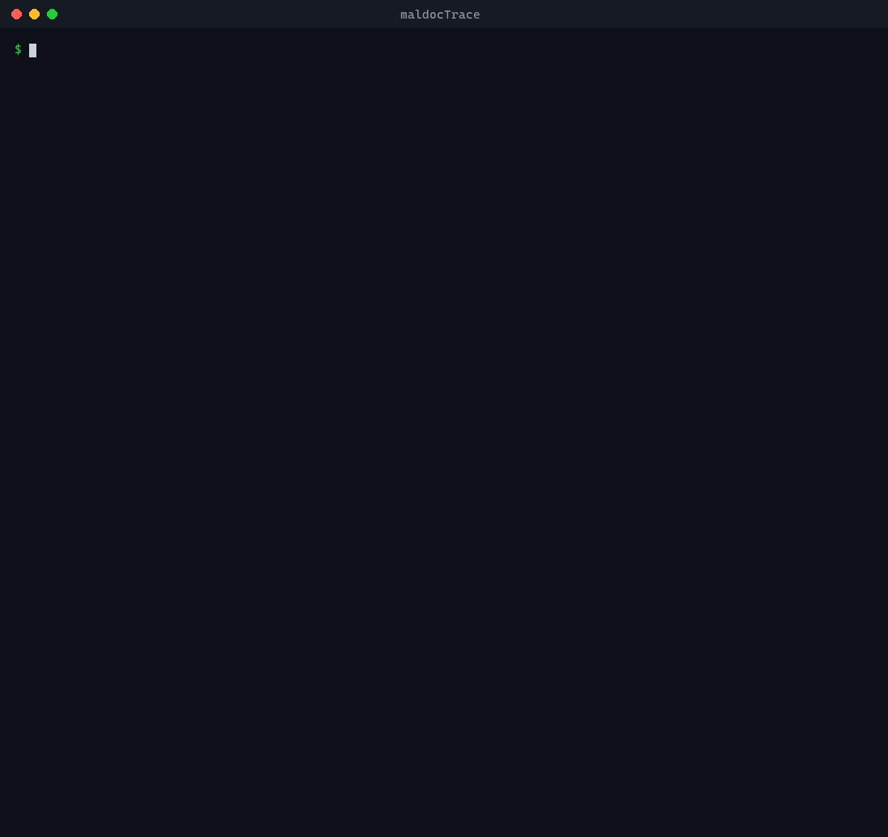

# MaldocTrace

MaldocTrace is a defensive analyzer for malicious documents. It extracts and emulates VBA, Excel 4.0 (XLM) and VBScript in a fully simulated environment and reports what the document *would* do: the commands it would run, the payloads it would decode and the files it would drop. It never executes the sample.

It covers Office (OLE, OOXML, RTF, SYLK, Word XML, MHT), OneNote sections, emails (`.eml`, `.msg`), ZIP/7z archives and ISO images, and follows multi-stage droppers (OneNote → VBScript → dropped script → `rundll32`) in one run. Every report starts with a verdict, a 0–100 risk score and the reasons behind it.



## Install

```bash
pip install maldoctrace        # or: pipx install maldoctrace / uv tool install maldoctrace
```

The wheel contains the static MaldocTrace binary for your platform (Windows, Linux and macOS, x64 and ARM64) and installs it as the `maldoctrace` command. The binary is the one published on the GitHub release of the same version.

## Command line

```bash
maldoctrace analyze sample.docm
maldoctrace analyze sample.one --format json
maldoctrace analyze ./samples --recursive --format jsonl
```

## Python

```python
import maldoctrace

report = maldoctrace.analyze("sample.one")          # JSON report as a dict
print(report["verdict"], report["risk_score"])
for cmd in report.get("commands") or []:
    print(cmd["command_line"])

report = maldoctrace.analyze_bytes(data, name="invoice.xls", passwords=["infected"])
```

Documentation, the full option list and the JSON schema are in the [project README](https://github.com/debugactiveprocess/MaldocTrace#readme).

MaldocTrace is released under the Apache License 2.0.
